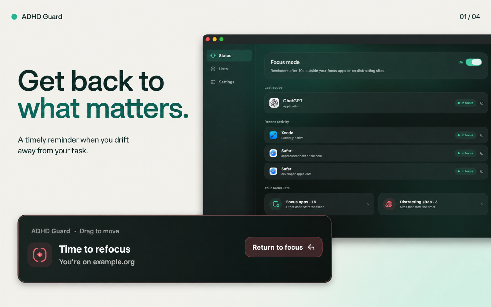
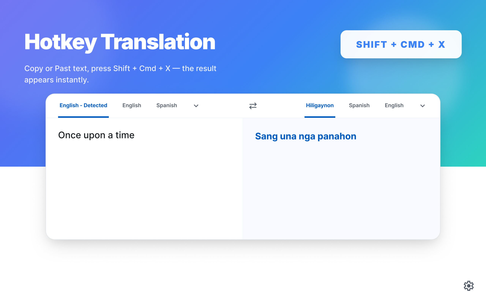

iOS · macOS · Fintech · Developer tools

# Kirill Piulziu

**Senior iOS Engineer · Lisbon, Portugal**

I build native Apple apps, from architecture and integrations to the details of the interface. My work spans fintech, crypto wallets, and small tools that make everyday work easier.

[Email](mailto:kirill.pyulzyu@gmail.com) · [Product portfolio](https://github.com/funkydevil/Portfolio)

---

## Independent projects

### [ADHD Guard](https://funkydevil.github.io/adhd-guard/)

A macOS menu bar app that helps you notice distractions and return to your task. App and website rules, adjustable reminders, and activity that stays on your Mac.

macOS · Focus & productivity

[Source code](https://github.com/funkydevil/ADHD-Guard) · [Website](https://funkydevil.github.io/adhd-guard/)

### [HotKey Translate](https://funkydevil.github.io/hotkey-translate/support.html)

Quick text translation from the macOS menu bar. Copy text, press a global shortcut, and open the translator without breaking your workflow.

macOS · Global shortcuts · Translation

[Source code](https://github.com/funkydevil/HotKey-Translate) · [Support](https://funkydevil.github.io/hotkey-translate/support.html)

## Engineering

| Area | Focus |
| :--- | :--- |
| Native apps | Swift, Objective-C, SwiftUI, UIKit |
| Architecture & data flow | MVVM, modular design, Combine, Swift concurrency |
| Product experience | Fintech, multi-chain wallets, token management, cross-network bridges |

My professional work includes **Defiway**, a multi-chain crypto wallet, and copytrading interfaces. [Explore selected product work →](https://github.com/funkydevil/Portfolio)

---

Based in Lisbon, Portugal · [Get in touch](mailto:kirill.pyulzyu@gmail.com)
